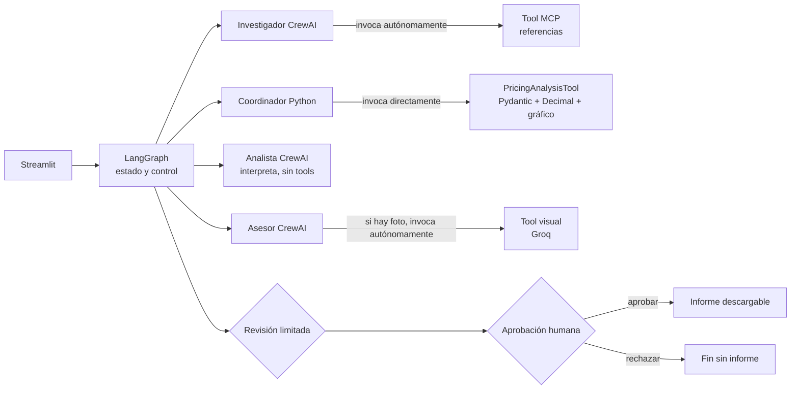

# AmiguPrecio

AmiguPrecio es un MVP local para que artesanas y pequeños negocios calculen un
precio sostenible para un amigurumi, lo contrasten con referencias comerciales
trazables y decidan si desean guardar un informe. No predice ventas ni promete
beneficios: combina cálculo determinista, agentes de IA y supervisión humana.

La fórmula es:

```text
coste de producción = materiales + (horas × tarifa por hora) + otros gastos
precio calculado = coste de producción / (1 - margen / 100)
```

El margen es margen sobre ventas, no un recargo sobre costes. El resultado no incluye
comisiones, impuestos ni gastos que la persona no haya introducido.

## Funcionalidades y arquitectura

- formulario Streamlit con costes, margen y fotografía opcional;
- cálculo monetario con `Decimal` y validación Pydantic;
- tres agentes CrewAI con responsabilidades distintas;
- consulta de referencias mediante cliente y servidor MCP reales;
- dataset local de 17 productos terminados con URL, fecha, tienda y procedencia;
- gráfico de comparación generado por Python;
- análisis visual real mediante Groq cuando se aporta una foto;
- LangGraph con estado tipado, rutas condicionales, un reintento máximo e
  interrupción humana;
- informe Markdown y gráfico descargables únicamente tras aprobación.



CrewAI aporta roles y uso autónomo de herramientas. MCP separa el investigador de la
fuente de referencias. LangGraph controla el orden, los errores, el único reintento,
el checkpoint y la pausa humana; no es un cuarto agente.

### Función real de cada agente

1. **Investigador:** invoca autónomamente `search_market_references`, que usa el
   cliente y servidor MCP. Conserva el resultado Pydantic original y distingue
   procedencia `live` de `saved`.
2. **Analista:** interpreta un resumen breve del resultado oficial de Python. No
   dispone de herramientas ni puede recalcular o sustituir los importes.
3. **Asesor comercial:** genera un JSON cualitativo validado con
   `CommercialAssessment`. Con fotografía, invoca autónomamente la herramienta
   visual.

`PricingAnalysisTool` es una herramienta propia con contrato Pydantic, pero en el
flujo de producción la ejecuta directamente el coordinador Python una sola vez. Esta
distinción evita presentar una operación determinista como decisión autónoma del
LLM.

## Referencias, cálculo y trazabilidad

La fuente web en directo disponible es el catálogo público de SweetLavenderCo. Tiene
timeout y un máximo de tres resultados. Para precios en EUR, o si la consulta falla o
queda vacía, el MCP usa `data/amigurumis_referencias.csv`. Ese archivo contiene 17
productos terminados verificados en USD, GBP, INR y EUR; no incluye patrones, kits ni
precios ambiguos. El respaldo local nunca se presenta como búsqueda web en directo.

Las monedas distintas no se mezclan ni convierten. Las referencias son precios
anunciados en sus fechas de consulta, no ventas realizadas. En el caso de demostración
la media de 41,55 EUR usa dos muñecas comparables y un juguete reversible menos
equivalente; por ello la muestra debe describirse como orientativa y heterogénea.

Python es la única fuente oficial de costes, precio, estadísticas y gráfico. La
revisión impide que el analista o el asesor sustituyan esas cifras. Un rechazo termina
sin informe; una aprobación reanuda el mismo `thread_id` y guarda una sola vez.

## Instalación en Windows

Requisitos: Git y [uv](https://docs.astral.sh/uv/).

```powershell
git clone https://github.com/elenacarino-max/AmiguPrecio.git
Set-Location AmiguPrecio
Copy-Item .env.example .env
uv sync --extra dev
```

Editar `.env` sin compartir ni versionar la clave:

| Variable | Uso |
|---|---|
| `GROQ_API_KEY` | Credencial obligatoria para agentes y visión |
| `GROQ_MODEL` | Modelo del investigador vía LiteLLM |
| `GROQ_ANALYST_MODEL` | Modelo opcional específico del analista |
| `GROQ_ADVISOR_MODEL` | Modelo opcional específico del asesor |
| `GROQ_VISION_MODEL` | Modelo del endpoint visual de Groq |
| `MAX_LLM_CALLS` | Valor documental; no aplica un corte automático actualmente |
| `MAX_ESTIMATED_COST_EUR` | Valor documental; no aplica un corte automático actualmente |

Los valores recomendados están en `.env.example`. Nunca añadas la clave real a Git.

Iniciar la interfaz:

```powershell
uv run streamlit run app.py
```

Ejemplos auxiliares:

```powershell
# MCP reproducible sin LLM ni llamada de pago
uv run python examples/phase2_demo.py

# Flujo LangGraph real e interactivo; consume Groq
uv run python examples/phase3_langgraph.py
```

## Pruebas y calidad

```powershell
uv run pytest
uv run ruff check .
```

La última ejecución funcional completa de Fase 4 superó 62 pruebas y Ruff. En la
auditoría final, una repetición de Pytest quedó bloqueada durante la colección por la
política Enterprise de integridad de código de Windows al cargar la DLL no firmada
`pandas_datetime.cp311-win_amd64.pyd`; no fue un fallo de prueba. No se ha desactivado
ni eludido la política. La evidencia y los pasos pendientes están en
`docs/auditoria_final.md`.

## Seguridad, privacidad y limitaciones

La fotografía es opcional. Se admiten JPEG, PNG y WebP de hasta 5 MB. La app valida
los píxeles, limita dimensiones, corrige orientación y recodifica sin EXIF. No acepta
URLs ni guarda la imagen, aunque envía sus bytes una vez a Groq. El modelo puede
describir rasgos visibles, pero no deducir material exacto, tamaño, horas, coste,
calidad o demanda.

Los errores externos se muestran sin secretos. Las iteraciones, tokens, reintentos y
timeouts están acotados; no existe todavía un medidor de coste con corte automático.
El checkpointer es `InMemorySaver`: reiniciar Streamlit pierde sesiones pendientes.
La UI informa por nodos completados, no ofrece telemetría intra-nodo de cada llamada.
El catálogo es pequeño y sus precios requieren revisión periódica.

## Entrega y autoría

El proyecto se ha desarrollado individualmente y el historial contiene commits
locales por hitos. No se simulan ramas, pull requests ni revisiones colaborativas que
no existieron.

- [Auditoría contra el briefing](docs/auditoria_final.md)
- [Guion de presentación de 7–10 minutos](docs/guion_presentacion.md)
- [Briefing original](docs/briefing.pdf)
