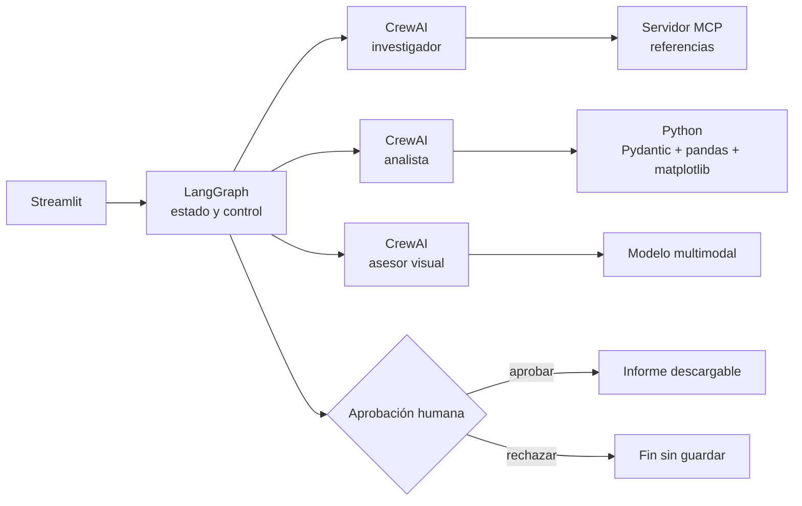

# AmiguPrecio

MVP para que artesanas y artesanos calculen un precio rentable para sus amigurumis y, en las siguientes fases, lo contrasten con referencias reales y trazables del mercado.

## Estado

**Fases 1 y 2 verificadas:** cálculo determinista, interfaz Streamlit inicial, tres agentes CrewAI, análisis con Pandas/Matplotlib y servidor MCP local por `stdio`. LangGraph, visión e informe final pertenecen a las fases siguientes y no se simulan en esta versión.

La fórmula implementada es:

```text
coste de producción = materiales + (horas × tarifa por hora) + otros gastos
precio calculado = coste de producción / (1 - margen / 100)
```

El margen es margen sobre ventas, no un recargo sobre costes. El resultado no incluye comisiones, impuestos ni gastos no declarados.

## Arquitectura objetivo (MVP)



CrewAI define roles y herramientas especializadas. LangGraph controla el orden, los límites, la revisión y la pausa humana; no duplica el trabajo de los agentes.

## Estructura

```text
AmiguPrecio/
├── app.py
├── docs/briefing.pdf
├── src/amiguprecio/
│   ├── models.py
│   └── pricing.py
├── tests/test_pricing.py
├── .env.example
└── pyproject.toml
```

## Instalación en Windows (PowerShell)

Requisitos: Git y [uv](https://docs.astral.sh/uv/). `uv` instalará una versión compatible de Python si hace falta.

```powershell
git clone https://github.com/elenacarino-max/AmiguPrecio.git
Set-Location AmiguPrecio
Copy-Item .env.example .env
uv sync --extra dev
```

No añadas claves a Git. La Fase 1 no consume ninguna API ni realiza llamadas de pago.

## Ejecutar

```powershell
uv run streamlit run app.py
```

## Pruebas y calidad

```powershell
uv run pytest
uv run ruff check .
```

## Hoja de ruta mínima

1. **Fase 1:** calculadora validada e interfaz base. Completada.
2. **Fase 2:** tres agentes CrewAI y herramientas; servidor y cliente MCP reales. Completada.
3. **Fase 3:** LangGraph con revisión limitada, errores, presupuesto, pausa/reanudación y visión.
4. **Fase 4:** comparación, gráfico, informe, aprobación/rechazo y pruebas de integración.
5. **Fase 5:** auditoría contra el briefing, documentación y guion de demo.

## Fuente de requisitos

El briefing oficial se conserva en `docs/briefing.pdf`. Sus mínimos prevalecen sobre decisiones auxiliares de implementación.

## Fase 2: agentes y MCP

La crew usa `Process.sequential` y contiene exactamente tres agentes: investigador, analista y asesor comercial. El investigador recibe la herramienta `search_market_references` mediante `MCPServerStdio`; el analista utiliza la calculadora existente, Pandas y Matplotlib; la tarea final exige `CommercialAssessment` como salida Pydantic.

La fuente en directo es el catálogo JSON público de SweetLavenderCo. La consulta tiene un timeout, un máximo de tres resultados y conserva URL, precio, moneda, fecha y procedencia `live`. Si falla o queda vacía, se consulta `data/amigurumis_referencias.csv` y cada registro se marca como `saved`. El CSV contiene 12 productos terminados verificados en tres tiendas; no contiene patrones, kits ni precios ambiguos.

```powershell
# Demostración MCP reproducible, sin LLM ni llamadas de pago
uv run python examples/phase2_demo.py

# Solo con credenciales y cuando se quiera probar la crew completa
uv run python examples/phase2_demo.py --run-llm
```

La API de Mercado Libre se probó como posible fuente, pero respondió HTTP 403. No se oculta como fuente funcional ni se sustituye por datos simulados. Los precios en USD no se convierten automáticamente a EUR; comparar monedas distintas requiere conversión explícita en una fase posterior.

