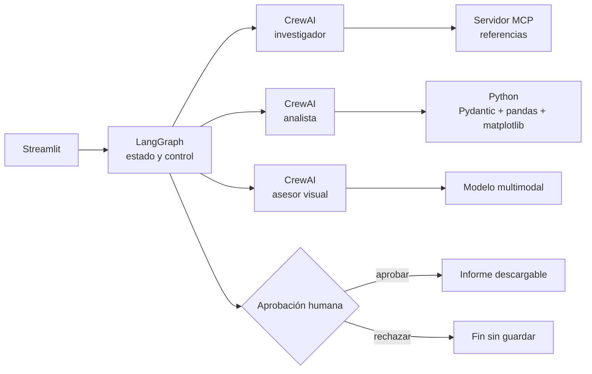

# AmiguPrecio

MVP para que artesanas y artesanos calculen un precio rentable para sus amigurumis y, en las siguientes fases, lo contrasten con referencias reales y trazables del mercado.

## Estado

**Fase 4 funcional:** cálculo determinista, interfaz Streamlit completa, tres agentes
CrewAI, servidor MCP local, comparación con referencias EUR, visión mediante Groq
y un `StateGraph` con revisión limitada, interrupción humana, reanudación y descargas.

La fórmula implementada es:

```text
coste de producción = materiales + (horas × tarifa por hora) + otros gastos
precio calculado = coste de producción / (1 - margen / 100)
```

El margen es margen sobre ventas, no un recargo sobre costes. El resultado no incluye comisiones, impuestos ni gastos no declarados.

## Arquitectura objetivo (MVP)



CrewAI define roles y herramientas especializadas. LangGraph controla el orden, los límites, la revisión y la pausa humana; no duplica el trabajo de los agentes.

## Estructura

```text
AmiguPrecio/
├── app.py
├── docs/briefing.pdf
├── src/amiguprecio/
│   ├── agents.py
│   ├── langgraph_workflow.py
│   ├── reporting.py
│   └── workflow.py
├── tests/
├── .env.example
└── pyproject.toml
```

## Instalación en Windows (PowerShell)

Requisitos: Git y [uv](https://docs.astral.sh/uv/). `uv` instalará una versión compatible de Python si hace falta.

```powershell
git clone https://github.com/elenacarino-max/AmiguPrecio.git
Set-Location AmiguPrecio
Copy-Item .env.example .env
uv sync --extra dev
```

No añadas claves a Git. La interfaz completa consume Groq al ejecutar los agentes y,
si se aporta una fotografía, realiza además una única llamada visual.

## Ejecutar

```powershell
uv run streamlit run app.py
```

## Pruebas y calidad

```powershell
uv run pytest
uv run ruff check .
```

## Hoja de ruta mínima

1. **Fase 1:** calculadora validada e interfaz base. Completada.
2. **Fase 2:** tres agentes CrewAI y herramientas; servidor y cliente MCP reales. Completada.
3. **Fase 3:** flujo híbrido y LangGraph con revisión limitada, errores,
   pausa/reanudación e informe. Completada.
4. **Fase 4:** visión, referencias EUR e interfaz completa. Completada.
5. **Fase 5:** auditoría contra el briefing, documentación y guion de demo.

## Fuente de requisitos

El briefing oficial se conserva en `docs/briefing.pdf`. Sus mínimos prevalecen sobre decisiones auxiliares de implementación.

## Fase 2: agentes y MCP

La solución contiene exactamente tres agentes: investigador, analista y asesor
comercial. El investigador recibe `search_market_references`, que usa el cliente y
servidor MCP reales; el cálculo Python se ejecuta fuera del LLM; y la salida del
asesor se valida localmente mediante `CommercialAssessment`.

La fuente en directo es el catálogo JSON público de SweetLavenderCo. La consulta tiene un timeout, un máximo de tres resultados y conserva URL, precio, moneda, fecha y procedencia `live`. Si falla o queda vacía, se consulta `data/amigurumis_referencias.csv` y cada registro se marca como `saved`. El CSV contiene 17 productos terminados verificados, incluidos cinco en EUR. Conserva también referencias en USD, GBP e INR, sin mezclar ni convertir monedas. No contiene patrones, kits ni precios ambiguos.

```powershell
# Demostración MCP reproducible, sin LLM ni llamadas de pago
uv run python examples/phase2_demo.py

# Solo con credenciales y cuando se quiera probar la crew completa
uv run python examples/phase2_demo.py --run-llm
```

La ejecución real usa `GROQ_API_KEY` y permite seleccionar el modelo con
`GROQ_MODEL`. El valor recomendado actualmente es `groq/openai/gpt-oss-20b`;
el prefijo `groq/` corresponde al enrutado de LiteLLM y el identificador del
modelo publicado por Groq es `openai/gpt-oss-20b`.

### Flujo híbrido verificable

La ejecución de Fase 3 separa responsabilidades deliberadamente:

1. El investigador CrewAI invoca autónomamente `search_market_references`, una
   herramienta que usa el cliente y servidor MCP reales y conserva el resultado
   original como modelos Pydantic.
2. El coordinador Python invoca `PricingAnalysisTool` directamente una sola vez.
   Esta ejecución no se presenta como una decisión autónoma del LLM y constituye
   la fuente oficial de costes, precio, estadísticas y gráfico.
3. El analista CrewAI interpreta el resultado Python sin herramientas ni capacidad
   para sobrescribir cifras.
4. El asesor CrewAI genera JSON cualitativo, validado después mediante
   `CommercialAssessment` y comprobado contra los valores oficiales.

Cada etapa conserva resultados parciales. Si un agente falla o devuelve una salida
vacía, no se repiten la consulta MCP ni los cálculos deterministas.

La API de Mercado Libre se probó como posible fuente, pero respondió HTTP 403. No se oculta como fuente funcional ni se sustituye por datos simulados. Los precios en USD no se convierten automáticamente a EUR; comparar monedas distintas requiere conversión explícita en una fase posterior.

### LangGraph y aprobación humana

`src/amiguprecio/langgraph_workflow.py` construye el recorrido investigación →
cálculo → analista → asesor → revisión → aprobación → informe. El estado de
checkpoint usa representaciones JSON y se revalida con Pydantic al entrar en cada
componente. La revisión permite como máximo un reintento del analista o asesor y
nunca repite automáticamente MCP ni un cálculo correcto.

El nodo de aprobación llama a `interrupt()`. La ejecución debe continuar mediante
`Command(resume=...)` y el mismo `thread_id`. Un rechazo termina sin escribir el
informe; una aprobación explícita genera un único Markdown.

```powershell
# Ejecución real e interactiva; consume Groq y consulta MCP una sola vez
uv run python examples/phase3_langgraph.py
```

Las pruebas de LangGraph usan sustitutos deterministas. Demuestran el flujo, los
errores, el reintento acotado y la pausa/reanudación, pero no se presentan como
ejecuciones reales de IA.

### Visión y privacidad

La fotografía es opcional. Se admiten JPEG, PNG y WebP de hasta 5 MB. La aplicación
comprueba que el archivo contiene píxeles reales, limita sus dimensiones, corrige la
orientación y lo recodifica sin EXIF. No acepta URLs ni persiste la imagen en disco.
Los bytes limpios se envían una vez como `data:` URL al modelo configurado mediante
`GROQ_VISION_MODEL` (por defecto `qwen/qwen3.8-27b`).

El modelo solo describe tipo aparente, colores, forma, detalles y rasgos comparables.
No puede deducir tamaño exacto, material, horas, coste, calidad o demanda. Un fallo
visual se registra como limitación y no invalida los cálculos o referencias.

La sesión conserva en memoria el grafo, el checkpointer, el `thread_id`, resultados y
decisión. Aprobar o rechazar usa `Command(resume=...)` sobre el mismo checkpoint, sin
repetir MCP, Python ni agentes. Al usar `InMemorySaver`, reiniciar el proceso de
Streamlit pierde las sesiones pendientes; los informes ya aprobados permanecen en
`output/streamlit/`.

